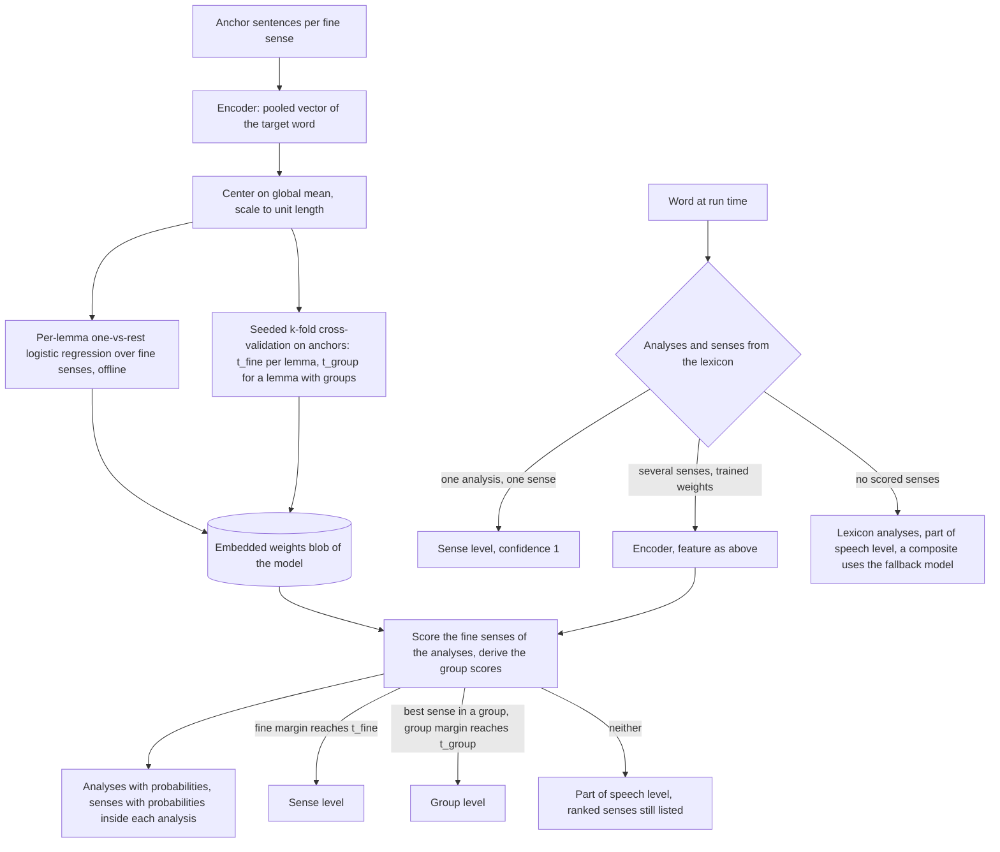

## Onnx Subsystem Design

### Overview

The Onnx subsystem is the package `DemaConsulting.WordSense.Onnx`. It holds everything the encoder models share:
verified model files, the ONNX encoder and its tokenizer, the trained per-lemma weights and the classifier that
scores the fine senses of an ambiguous word and decides the level of the answer. It is the only package with a
third-party runtime dependency, ONNX Runtime, and it references only the core package. Its single public type is the
abstract `OnnxWordSenseModel`; the model packages derive from it and supply the model identity. The encoder model is
usable on its own. The classifier scores the fine senses of the lemmas that have trained weights (the lemmas of the
relabeled corpus in this version) with the encoder and decides the level of the answer; every word whose
lemma has no trained weights is answered from the lexicon alone (with all its lemmas and parts of speech equally likely
and no scored
senses). The
statistical choice among the analyses of such a word is not made in this package: the MiniLM and BertBaseCased
packages compose the encoder model with the Basic model through the core `FallbackWordSenseModel`, which uses the Basic
result for every word the encoder did not score.

The subsystem contains seven units:

- **OnnxWordSenseModel**: file management, lazy loading and classification.
- **OnnxClassifier**: lexicon resolution, analysis and sense scoring, level decision and the lexicon-only answer of a
  word without scored senses.
- **OnnxEncoder**: tokenization, inference and mean pooling.
- **WordPieceTokenizer**: the BERT WordPiece tokenizer, uncased or cased.
- **ModelDownloader**: ordered, verified download of model files.
- **DownloadMirror**: validated download source configuration (the mirror settings of `DownloadOptions`).
- **LemmaWeights**: the weights blob reader, the matching to the word image, the feature computation, the scoring, the
  group scores and the levels.

### Interfaces

It exposes the abstract `OnnxWordSenseModel` (implements `IDownloadableWordSenseModel`, and so `IWordSenseModel`, which
is `IDisposable`) with the properties
`HiddenSize` and `ModelId`. Its constructor is private protected, so only the WordSense model packages can derive.
It consumes the core contracts and the `WordLexicon` (analyses, senses, groups), the ONNX Runtime inference API,
HTTP(S) for downloads, the file system for the model store, and the embedded
weights of the derived model's assembly. All other members are internal and visible to the MiniLM and BertBaseCased
packages, the builder and the test projects.

The model description passed by a derived class is an internal `ModelSpec`: the model id, the files with their
SHA-256 digests, the ONNX file name, the vocabulary file name, whether the tokenizer lower-cases, the assembly and
resource name of the weights, and the hidden size.

### Design

The units collaborate as follows:

1. `OnnxWordSenseModel.EnsureModelAsync` verifies an explicit model directory with `ModelDownloader.Verify`, or calls
   `ModelDownloader.EnsureAsync`, which builds the mirror with `DownloadMirror` (from `DownloadOptions` or the
   environment), reuses valid files from the store and downloads the others. The downloader units keep their raw
   exceptions as internal vocabulary; `OnnxWordSenseModel` wraps them at the public boundary as
   `ModelUnavailableException`, `ModelIntegrityException` or `DownloadConfigurationException` (see _OnnxWordSenseModel
   Unit Design_), and likewise reports a damaged embedded weights resource or ONNX file from `ClassifyAsync` as a
   `ModelIntegrityException`.
2. `OnnxWordSenseModel.ClassifyAsync` (lazily ensuring first when a word needs the encoder) loads the embedded weights
   once through `LemmaWeights` (blob reader and all-or-nothing match to the word image), opens one `OnnxEncoder` once
   (which builds a `WordPieceTokenizer` and the ONNX session) and runs an `OnnxClassifier` over the shared encoder and
   weights.
3. `OnnxClassifier.ClassifyAsync` resolves every word from the lexicon, asks `OnnxEncoder` for the pooled vector of
   the words that need context, turns each vector into a feature with the global mean of the weights, scores the
   fine senses of the word's analyses with `LemmaWeights`, lets `LemmaWeights` decide the level of the answer and
   builds the result (the analyses with their probabilities and the senses inside them, the selected analysis, the
   level, the confidence and the ids). A word without scored senses is answered from the lexicon alone.

Training and inference share the feature computation, so the builder and the classifier cannot diverge. The encoder
and the weights are shared by all callers of one model and are released when the model is disposed.

Layer rule: this package references the core package and ONNX Runtime only; it never uses the Basic model.
The MiniLM and BertBaseCased packages reference this package and the core package, and compose the
two models.

### Classification Approach

This section describes how the encoder models (MiniLM and BertBaseCased) decide the sense of a word and at which
level they answer. The Basic model does not use embeddings at all: it tags the sentence with a hidden Markov model and
weighs context cues, and it answers the part of speech (see _Core Subsystem Design_). The scoring of fine senses with
the encoder is specified here and implemented by `OnnxClassifier` (see _Classification (Run Time)_).

#### Vocabulary

- A **fine sense** is one Open English WordNet sense (or a project sense where WordNet has none) with an id
  `lemma#slug`; sense ids are frozen. A **group** exists only where curated: a set of at least two, but not all, fine
  senses of one lemma and one part of speech that are closely related in meaning and easily confused, with an id
  `lemma#group:slug` in a namespace of its own (a group id never equals a sense id); a fine
  sense is in at most one group, and a lemma may have no group at all. Group ids are versioned per data release and are
  not frozen.
- An **analysis** is a lemma, a part of speech and features of a word form. A form has one or more analyses.
- The **level** of an answer is `Sense`, `Group`, `PartOfSpeech` or `None`. The levels nest: `None` above
  `PartOfSpeech` (lemma and part of speech), above the optional `Group`, above `Sense`. `None` is only for a word that
  is not in the lexicon. When the classifier is unsure
  between senses it steps up to the next level that exists: the group they share, otherwise the part of speech. The
  **margin** of a level is the
  difference between the best and the second-best candidate of that level; the **threshold** of a level is the margin
  at which the lemma's own evidence meets the precision target.
- The **analyses** of a result are every analysis of the word with its probability (summing to one); inside an analysis
  the **senses** are its fine senses with their probabilities given the analysis (summing to one). A consumer can apply
  its own grouping to them (see _Analyses and senses_ under _Classification (Run Time)_).

#### Intuition and Actual Method

The intuition is nearest centroid: give every fine sense of an ambiguous word a set of anchor sentences, embed the
word in each one, average the embeddings of a sense into a centroid, and choose the sense whose centroid is closest to
the embedding of the word in the new sentence, using cosine similarity. The implementation does not store centroids and
does not compute cosine similarity. It trains, offline, a small linear classifier per lemma on the same kind of
embeddings, and the run time only evaluates that classifier. Because the embeddings are mean-centered and scaled to
unit length, a linear classifier on them is a learned refinement of nearest centroid with cosine similarity: the
weights are free to emphasize the directions that separate the senses instead of treating all directions alike.

Fine senses of one lemma are often hard to separate while their group, where the lemma has one, is not. The classifier
therefore answers at the finest level it can support: the fine sense when its margin reaches the lemma's fine threshold,
otherwise, for a lemma that has groups and a best sense that is in a group, the group when the group margin reaches
the lemma's group threshold, and otherwise the part of speech, with the ranked senses of the analysis still listed. A
known word is never answered as unknown: an uncertain word is answered at the part of speech level.

The flow, from the training data to a decision:

#### Training (Offline)

The builder command `weights <modelId>` trains one weights blob per encoder model. Its inputs come from the corpus
and the word data:

- The sense inventory (fine senses, their groups where curated and their ids) comes from the word data compiled into
  the word image,
  so training and the run time read one inventory.
- `corpus/anchors` is the training data: sentences with the target word marked and labeled with its fine sense id.
- `corpus/holdout` holds sentences that are never trained on; the builder refuses anchors and holdout that overlap.
  Holdout, real-text and suite sentences and the independent evaluation sets are never used for fitting, for
  cross-validation or for choosing a threshold.

The training runs as follows:

1. Every anchor sentence is encoded once. The hidden states of the target word are mean-pooled over its word pieces
   (`FeatureExtractor` and the encoder). The builder keeps the pooled vectors in a persistent cache, so a retraining
   encodes only sentences it has not encoded before (see the `WordSenseBuilder` design).
2. Every vector is centered on the global mean and scaled to unit length. The mean is the one stored in the existing
   weights blob of the model (frozen) and is computed from all pooled anchor vectors only when there is no such blob,
   when it names another model or has another dimension, or when `--recompute-mean` is given. Freezing it makes the
   features of a lemma depend on that lemma's anchors alone, so editing the anchors of one lemma changes only the
   weights of that lemma. The mean is stored in the blob, and the run time applies the same feature computation.
3. Per lemma, a one-versus-rest L2-regularized logistic regression is fitted over the fine senses that have anchors:
   one weight row and one bias per fine sense, also for a lemma with two senses. A lemma needs at least two senses
   with anchors to get weights; a sense with a single anchor stays in training. The fit is a Newton method with
   fixed iteration rules, so the same input gives the same weights (`LogisticTrainer`, `WeightsTrainer`,
   `ModelTrainer`); when a lemma has fewer anchors than the encoder has dimensions it runs in the span of the anchors
   (`KernelBasis`, `LemmaFitter`), which finds the same optimum much faster.
4. Per lemma, a fine threshold, and for a lemma that has groups a group threshold, are chosen by seeded k-fold
   cross-validation (k = 5) on the lemma's anchors only. Each
   fold is fitted without its held-out anchors and scores them. From the out-of-fold scores the builder takes, for every
   anchor, the fine margin and whether the best fine sense is right, and (for a lemma that has groups, over the anchors
   whose best sense is in a group, and whose fine margin is below `t_fine`, the rows that fall through to the group
   level) the group margin and whether the best group is
   right (the group scores are derived as at run time). The fine threshold `t_fine` is the smallest margin such that the
   out-of-fold answers whose margin is at least that value reach the precision target (with at least three answers);
   `t_group` is found the same way on the group answers, and only for a lemma that has groups. The target is 95%
   precision for both encoders. A level whose target is never reached gets the
   threshold "never" and is never answered for that lemma. The result is deterministic for a given seed.
5. Per form with several lemmas or tenses (`left`, `bases`, `rows`, `found`, `read`, `reread`), a small form chooser is
   fitted the same way over analysis labels, from the chooser rows of `corpus/choosers`: sentences of the form
   labeled with the lemma of the analyses they stand for, or, for the forms of one lemma that differ in tense (`read`,
   `reread`), with the analysis (`lemma/features`). The chooser has its own threshold, chosen by the same
   cross-validation; a form whose rows do not cover every analysis gets no chooser and is answered from the lexicon.
6. The weights (header with the model id, the dimension, the global mean and the hash of the inventory; per lemma the
   sense ids, the thresholds, the rows and the form choosers) are written to the blob that is embedded in the
   model package (`WeightsBlobWriter`, read at run time by `WeightsBlob` into `LemmaWeights` entries). The rows are
   stored as float16; a gate test requires that this changes the measured fine accuracy by no more than 0.2 percentage
   point against full precision.

Group scores are derived from the fine scores at run time (see _Classification_), so the blob has no group rows. If
the derived group answers ever lose more than one point of accuracy against a dedicated group classifier, group rows
would be added to the format.

Weights are per model: MiniLM and BertBaseCased each have their own blob, trained from the same corpus, so both cover
the same lemmas, and each blob carries the thresholds calibrated on the embeddings of its own encoder, so the level of
an answer is decided against the evidence of its own encoder.

#### Classification (Run Time)

`OnnxClassifier` resolves each word from the lexicon first: the analyses of the word and, for each analysis, the fine
senses of its lemma and part of speech. It then decides:

1. **Unknown word.** No analysis: `ClassifyResult.Unknown`: not known, no analyses, no details, level `None`,
   confidence 0.
2. **One analysis and one sense.** The word has one analysis whose lemma and part of speech have exactly one fine
   sense: the analysis has probability 1 and lists that sense with probability 1, and the answer is that sense at the
   `Sense` level with confidence 1. The encoder is not run, and a text in which every word is of this kind needs no
   model file at all.
3. **Several senses and trained weights.** The word is pending. The encoder runs once over the text, the pooled vector
   of the word is turned into the feature, and the classifier scores the fine senses of every analysis of the word
   so every part of speech the word can have is reachable, such as the preposition use of `like`) and no sense of any
   other lemma. The softmax of the fine scores gives each sense a probability; the probability of a lemma and part of
   speech (a slot) is the mass of its senses, the probability of a sense given its slot is its mass renormalized within
   the slot, and the analyses of a slot that differ only in features (`cut` as an infinitive and as a past tense) share
   the probability of the slot, equally unless a chooser tells them apart. A
   form whose analyses belong to several lemmas or tenses first gets the probabilities of its analyses from its form
   chooser. The level is then decided, for the selected analysis (the best variant of the most probable slot):
   - If the margin of the best fine sense reaches the lemma's `t_fine`, the answer is the fine sense at the `Sense`
     level, with the sense id and, when the sense is in a group, its group id.
   - Otherwise, for a lemma that has groups and a best sense that is in a group, the answer is that group at the
     `Group` level, with the group id only, when the margin of the group reaches `t_group`. The member senses of the
     group stay listed in the senses of the selected analysis.
   - Otherwise (the lemma has no groups, the best sense is in no group, or the group margin is below `t_group`) the
     model steps from the sense to the part of speech: the answer is the selected analysis at the `PartOfSpeech`
     level with the probability of its slot as the confidence; the ranked senses of the analysis still show the likely senses
     and groups. The model never answers at the `Group` level for a lemma without groups or for a group whose
     threshold is not met, and never at `None` for a known word.

   The confidence is the probability of the answer at its level: at `PartOfSpeech` the probability of the slot of the
   selected analysis; at `Group` that probability times the sum of the probabilities of the member senses of the group
   within the slot; at `Sense` that probability times the probability of the answered sense within the slot, so it is
   the probability of the sense whatever the number of feature variants of the slot. It grows
   monotonically with the margin of the best fine score over the others, is between 0 and 1 and is comparable only
   within one result. The margin and the lemma's thresholds decide the level; the confidence reports how likely the
   answer is.

   **Analyses and senses.** Whatever the level answered, the result lists every analysis of the word with its
   probability and, inside each analysis, the senses of its lemma and part of speech ranked by their probability given
   the slot (equal probabilities keep inventory order, nothing is truncated), so both lists sum to one. A consumer
   that maps senses to its own categories sums `analysis.Probability * sense.Probability` per category over all
   analyses, so
   `bow#archery` at 0.48 and `bow#violin` at 0.41 give 0.89 for one category even when the result itself is answered
   only at the part-of-speech level. A non-empty senses list in the selected analysis is also what makes a
   `FallbackWordSenseModel` use this result instead of its fallback (the composite may still give the equally likely
   variants of a slot the proportions of its fallback; the encoder itself never reads Basic).
4. **No scored senses.** The lemma has no trained weights, the encoder produced no usable vector, or a multi-lemma form
   has no chooser: the word is answered from the lexicon alone. Its lemmas and parts of speech (slots) are equally
   likely (probability 1 for a single one, 1/s for s of them) and the analyses of a slot split its probability equally,
   the first analysis of the lexicon is the selected one, the senses lists are
   empty (a word with a single analysis whose lemma and part of speech have exactly one sense lists that sense with
   probability 1 and is answered at the sense level), and the level is `PartOfSpeech` with the probability of the
   slot of the selected analysis as confidence. No fine sense is guessed. The choice among the analyses is left to the fallback
   model of a composition: a word of this kind has no scored senses, so a
   `FallbackWordSenseModel` answers it with its fallback model, which the MiniLM and BertBaseCased packages set to the
   Basic model. A word with a single analysis but many senses and no weights (`bank` when untrained) is answered the
   same way, at the part of speech level with confidence 1.

The shipped weights of this version cover the lemmas of the relabeled corpus (see `corpus/README.md` for their number)
and the form choosers of the forms whose chooser rows cover every analysis; the lexicon answers every other word and
every form of several lemmas without a chooser (the cases 1, 2 and 4), and case 3 holds for the trained lemmas.

#### Evaluation Scope

The builder's `evaluate` command scores a model on the holdout sentences and reports, per level, the share of words
answered at the sense, group and part-of-speech level and the precision at each level. The lemmas of these rows are
trained lemmas, so the published encoder accuracy reflects the trained lemmas only; the words answered by the fallback
are measured with the Basic model. Holdout sentences come from the same generator as the anchors, so their accuracy is
optimistic; the independent real-text evaluation described in the `WordSenseBuilder` design is the measure of the
shipped behavior.

#### Rationale

The approach follows a feasibility spike on the 34 seed lemmas (972 anchor sentences, 69 senses, 1,390 held-out
sentences) that used the hidden state of the target token of the raw int8 encoders. The figures are historical spike
evidence, not the published metrics:

| Classifier on the target-token embedding | BertBaseCased | MiniLM |
| --- | ---: | ---: |
| Nearest centroid, cosine similarity | 98.3% | 94.3% |
| Per-lemma linear classifier on mean-centered, unit-length embeddings | 98.9% | 97.3% |

Several prototypes per sense did not improve on one centroid (98.1% to 98.5%, within noise). The linear classifier
closed most of the gap of the smaller model, was insensitive to the choice between a linear support vector machine
and L2 logistic regression and to the regularization strength (all within 0.5 points), and features from neighboring
tokens hurt. Logistic regression was adopted for both models because it lifts the smaller model, keeps one code path
for both, and yields scores that are well behaved enough to derive the per-lemma thresholds. Group scores follow from
the fine scores because a fine-to-group roll-up measured at least as accurate as a dedicated group classifier, and
because it keeps the two levels consistent without a second set of rows.

### Adding a New ONNX Model

`OnnxWordSenseModel` is extended only by packages of this repository: its constructor is `private protected` and the
internal types (`ModelSpec`, `ModelFile`) are visible only to the in-repo packages, the builder and the tests. It is
not a public extension point. A contributor adds a model as follows:

1. Put the encoder files in `model/<model-id>/` (Git LFS) with `SHA256SUMS`, a `LICENSE` (the text of the license of the
   model, a plain Git file) and a README that records the source, license, the changes and the preparation steps (for
   example `tools/model-prep/make-bert-encoder.py`).
2. Create a package `DemaConsulting.WordSense.<Name>` that references `DemaConsulting.WordSense.Onnx` and
   `DemaConsulting.WordSense` (for the Basic model), with an internal sealed encoder class that derives from
   `OnnxWordSenseModel` and
   passes a `ModelSpec` (model id, each `ModelFile` with its SHA-256 and
   exact length, ONNX and vocabulary file names, whether the tokenizer lower-cases, the weights assembly and resource
   name, the hidden size) and a default maximum sequence length of 128, and a public sealed model class that wraps a
   `FallbackWordSenseModel` of the encoder class (primary) and a `BasicWordSenseModel` (fallback).
3. Register the model in the builder's `ModelCatalog`, run `weights <modelId>` to train the weights and the per-lemma
   thresholds for that encoder and embed the resulting `weights.bin` as the manifest resource named in the spec, and run
   `evaluate <modelId>` to record the per-level accuracy in the model comparison table (`docs/user_guide/model-table.md`).
4. Add the test project, the requirements, the design and verification documents, the SysML2 model entries and the
   review-set entries that the other model packages have.
