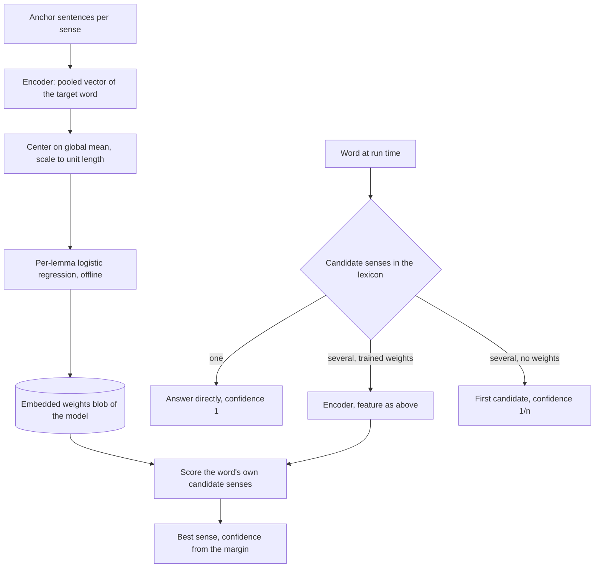

## Onnx Subsystem Design

### Overview

The Onnx subsystem is the package `DemaConsulting.WordSense.Onnx`. It holds everything the encoder models share:
verified model files, the ONNX encoder and its tokenizer, the trained per-lemma weights and the classifier that
scores the senses of an ambiguous word. It is the only package with a third-party runtime dependency, ONNX Runtime.
Its single public type is the abstract `OnnxWordSenseModel`; the model packages derive from it and supply the model
identity.

The subsystem contains seven units:

- **OnnxWordSenseModel**: file management, lazy loading and classification.
- **OnnxClassifier**: lexicon lookup and sense scoring.
- **OnnxEncoder**: tokenization, inference and mean pooling.
- **WordPieceTokenizer**: the BERT WordPiece tokenizer, uncased or cased.
- **ModelDownloader**: ordered, verified download of model files.
- **DownloadMirror**: validated mirror configuration.
- **LemmaWeights**: the weights blob reader, the matching to the lexicon, the feature computation and the scoring.

### Interfaces

It exposes the abstract `OnnxWordSenseModel` (implements `IWordSenseModel`, which is `IDisposable`) with the properties
`HiddenSize` and `ModelId`. Its constructor is private protected, so only the WordSense model packages can derive.
It consumes the core contracts and the `WordLexicon` lookup, the ONNX Runtime inference API, HTTP(S) for downloads, the
file system for the model store, and the embedded weights of the derived model's assembly. All other members are
internal and visible to the MiniLM and BertBaseCased packages, the builder and the test projects.

The model description passed by a derived class is an internal `ModelSpec`: the model id, the files with their
SHA-256 digests, the ONNX file name, the vocabulary file name, whether the tokenizer lower-cases, the assembly and
resource name of the weights, and the hidden size.

### Design

The units collaborate as follows:

1. `OnnxWordSenseModel.EnsureModelAsync` verifies an explicit model directory with `ModelDownloader.Verify`, or calls
   `ModelDownloader.EnsureAsync`, which builds the mirror with `DownloadMirror` (from `MirrorOptions` or the
   environment), reuses valid files from the store and downloads the others.
2. `OnnxWordSenseModel.ClassifyAsync` (lazily ensuring first when a word needs context) loads the embedded weights
   once through `LemmaWeights` (blob reader and
   all-or-nothing match to the lexicon), opens one `OnnxEncoder` once (which builds a `WordPieceTokenizer` and the ONNX
   session) and runs an `OnnxClassifier` over the shared encoder and weights.
3. `OnnxClassifier.ClassifyAsync` resolves every word from the lexicon, asks `OnnxEncoder` for the pooled vector of
   the words that need context, turns each vector into a feature with the global mean of the weights, and scores the
   word's candidate senses with `LemmaWeights`.

Training and inference share the feature computation, so the builder and the classifier cannot diverge. The encoder
and the weights are shared by all callers of one model and are released when the model is disposed.

### Classification Approach

This section describes, as built, how the encoder models (MiniLM and BertBaseCased) decide the sense of a word. The
Basic model does not use embeddings at all: it tags the sentence with a hidden Markov model and weighs context cues
(see _Basic Subsystem Design_).

#### Intuition and Actual Method

The intuition is nearest centroid: give every sense of an ambiguous word a set of anchor sentences, embed the word in
each one, average the embeddings of a sense into a centroid, and choose the sense whose centroid is closest to the
embedding of the word in the new sentence, using cosine similarity. The implementation does not store centroids and
does not compute cosine similarity. It trains, offline, a small linear classifier per lemma on the same kind of
embeddings, and the run time only evaluates that classifier. Because the embeddings are mean-centered and scaled to
unit length, a linear classifier on them is a learned refinement of nearest centroid with cosine similarity: the
weights are free to emphasize the directions that separate the senses instead of treating all directions alike.

The flow, from the training data to a decision:

#### Training (Offline)

The builder command `weights <modelId>` trains one weights blob per encoder model. Its inputs come from the corpus:

- `corpus/senses` is the inventory: the lemmas and their labeled senses.
- `corpus/anchors` is the training data: sentences with the target word marked and labeled with its sense. A label
  has at least a dozen sentences, about 16 on average.
- `corpus/holdout` holds sentences that are never trained on; the builder refuses anchors and holdout that overlap.

The training runs as follows:

1. Every anchor sentence is encoded once. The hidden states of the target word are mean-pooled over its word pieces
   (`FeatureExtractor` and the encoder). The builder keeps the pooled vectors in a persistent cache, so a retraining
   encodes only sentences it has not encoded before (see the `WordSenseBuilder` design).
2. Every vector is centered on the global mean and scaled to unit length. The mean is the one stored in the existing
   weights blob of the model (frozen) and is computed from all pooled anchor vectors only when there is no such blob,
   when it names another model or has another dimension, or when `--recompute-mean` is given. Freezing it makes the
   features of a lemma depend on that lemma's anchors alone, so editing the anchors of one lemma changes only the weights
   of that lemma. The mean is stored in the blob, and the run time applies the same feature computation.
3. Per lemma, the classifier is fitted on the features of that lemma's anchors: a binary logistic regression for two
   senses (one weight row, the two scores are the activation and its negation) or one-versus-rest logistic regression
   for more (one row per sense). The fit is an L2-regularized Newton method with fixed iteration rules, so the same
   input gives the same weights (`LogisticTrainer`, `WeightsTrainer`, `ModelTrainer`).
4. Each lemma also gets an abstain margin. When it has enough anchors, the builder chooses it by cross-validation as
   the smallest score margin at which the answers from that margin upward reach the target accuracy while a minimum
   share of the sentences stays answered. A lemma with too few anchors gets the median margin of the others (the one
   value that still depends on other lemmas: editing a lemma with enough anchors can move the median).
5. The weights (per lemma: the class ids of its senses, the weight rows, the biases and the abstain margin) and the
   global mean are written to the blob that is embedded in the model package (`WeightsBlobWriter`, read at run time by
   `WeightsBlob` into `LemmaWeights` entries).

Weights are per model: MiniLM and BertBaseCased each have their own blob, trained from the same corpus, so both cover
the same lemmas (currently 744).

#### Classification (Run Time)

`OnnxClassifier` resolves each word from the lexicon first and decides by the number of candidate senses:

1. **One candidate.** The word is answered directly with that sense and confidence 1. The encoder is not run, and a
   text in which every word is of this kind needs no model file at all.
2. **Several candidates and the lemma has trained weights.** The word is pending. The encoder runs once over the
   text, the pooled vector of the word is turned into the feature, and the classifier scores only the senses the word
   itself can have in the lexicon (and the weights were trained for), not every sense of the lemma. The best sense is
   always returned in `Details`; there is no refusal. The confidence is formed from the margin `m` between the best
   and the second-best score and the lemma's abstain margin `a`: `clamp(0.5 + 0.5 * (m - a) / max(a, 0.5), 0, 1)`. It
   grows with the margin and is exactly 0.5 where the lemma's own abstain rule would have declined, so the abstain
   margin shifts the confidence rather than withholding the answer; the caller applies its threshold. If only one
   candidate remains among the trained senses, the margin is infinite and the confidence is 1. If the encoder
   produces no vector for the word, the result is no sense with confidence 0.
3. **Several candidates but no trained weights.** The word is answered with its first lexicon candidate, the most
   frequent sense of the dictionary, with confidence `1/n` for `n` candidates, and the encoder is not consulted for
   it. This is a current limitation: only the trained lemmas (currently 744) are disambiguated by the encoder models.
   Common words with several parts of speech, such as `need`, `look`, `help`, `back` and `right`, have no weights
   today, and the Basic tagger is the model that covers them from context. A trailing `Auxiliary` candidate (such as
   the modal sense of `will`) is not counted as a candidate and is never answered by an encoder model, because no
   weights are trained for it; a word whose only extra candidate is `Auxiliary` therefore counts as having one sense.

#### Evaluation Scope

The builder's `evaluate` command scores a model on the holdout sentences and on the real-text sentences. The lemmas
of all these rows are trained lemmas, so the published encoder accuracy reflects the trained lemmas only. It says
nothing about the words of case 3, which receive the first dictionary sense.

#### Rationale

The approach follows a feasibility spike on the 34 seed lemmas (972 anchor sentences, 69 senses, 1,390 held-out
sentences) that used the hidden state of the target token of the raw int8 encoders. The figures are historical spike
evidence, not the current published metrics:

| Classifier on the target-token embedding | BertBaseCased | MiniLM |
| --- | ---: | ---: |
| Nearest centroid, cosine similarity | 98.3% | 94.3% |
| Per-lemma linear classifier on mean-centered, unit-length embeddings | 98.9% | 97.3% |

Several prototypes per sense did not improve on one centroid (98.1% to 98.5%, within noise). The linear classifier
closed most of the gap of the smaller model, was insensitive to the choice between a linear support vector machine
and L2 logistic regression and to the regularization strength (all within 0.5 points), and features from neighboring
tokens hurt. Logistic regression was adopted for both models because it lifts the smaller model, keeps one code path
for both, and yields scores that are well behaved enough to derive the abstain margin.

### Adding a New ONNX Model

`OnnxWordSenseModel` is extended only by packages of this repository: its constructor is `private protected` and the
internal types (`ModelSpec`, `ModelFile`) are visible only to the in-repo packages, the builder and the tests. It is
not a public extension point. A contributor adds a model as follows:

1. Put the encoder files in `model/<model-id>/` (Git LFS) with `SHA256SUMS` and a README that records the source,
   license and the preparation steps (for example `tools/model-prep/make-bert-encoder.py`).
2. Create a package `DemaConsulting.WordSense.<Name>` that references `DemaConsulting.WordSense.Onnx`, with a sealed
   class that derives from `OnnxWordSenseModel` and passes a `ModelSpec` (model id, each `ModelFile` with its SHA-256 and
   exact length, ONNX and vocabulary file names, whether the tokenizer lower-cases, the weights assembly and resource
   name, the hidden size) and a default maximum sequence length of 128.
3. Register the model in the builder's `ModelCatalog`, run `weights <modelId>` to train the weights and embed the
   resulting `weights.bin` as the manifest resource named in the spec, and run `evaluate <modelId>` to record the
   accuracy in the build notes.
4. Add the test project, the requirements, the design and verification documents, the SysML2 model entries and the
   review-set entries that the other model packages have.
