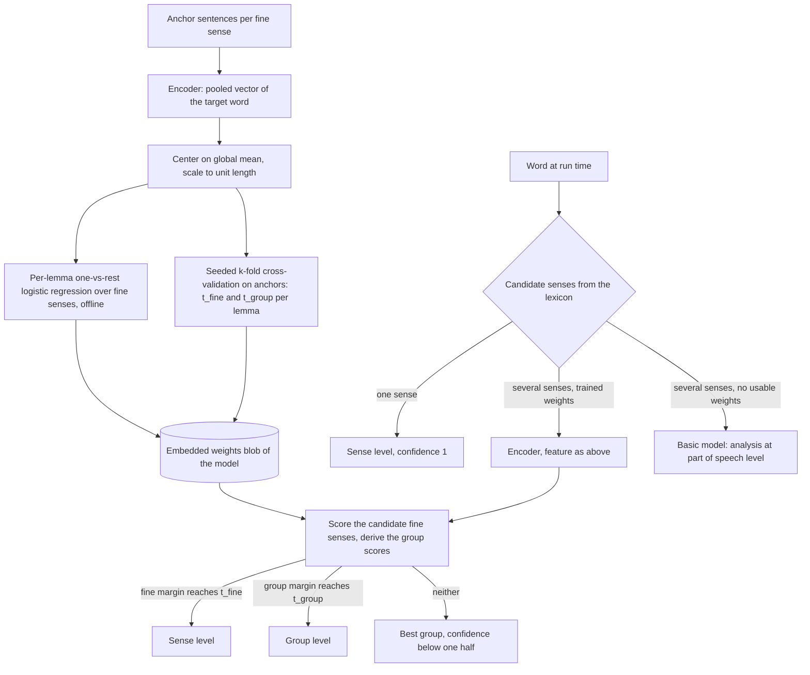

## Onnx Subsystem Design

### Overview

The Onnx subsystem is the package `DemaConsulting.WordSense.Onnx`. It holds everything the encoder models share:
verified model files, the ONNX encoder and its tokenizer, the trained per-lemma weights and the classifier that
scores the fine senses of an ambiguous word and decides the level of the answer. It is the only package with a
third-party runtime dependency, ONNX Runtime, and it builds on the Basic package, whose statistical model answers the
words the encoder was not trained for. Its single public type is the abstract `OnnxWordSenseModel`; the model packages
derive from it and supply the model identity.

The subsystem contains seven units:

- **OnnxWordSenseModel**: file management, lazy loading, the owned fallback model and classification.
- **OnnxClassifier**: lexicon resolution, candidate selection, level decision and fallback.
- **OnnxEncoder**: tokenization, inference and mean pooling.
- **WordPieceTokenizer**: the BERT WordPiece tokenizer, uncased or cased.
- **ModelDownloader**: ordered, verified download of model files.
- **DownloadMirror**: validated mirror configuration.
- **LemmaWeights**: the weights blob reader, the matching to the word image, the feature computation, the scoring, the
  group scores and the levels.

### Interfaces

It exposes the abstract `OnnxWordSenseModel` (implements `IWordSenseModel`, which is `IDisposable`) with the properties
`HiddenSize` and `ModelId`. Its constructor is private protected, so only the WordSense model packages can derive.
It consumes the core contracts and the `WordLexicon` (analyses, senses, groups), the Basic package model as the
fallback, the ONNX Runtime inference API, HTTP(S) for downloads, the file system for the model store, and the embedded
weights of the derived model's assembly. All other members are internal and visible to the MiniLM and BertBaseCased
packages, the builder and the test projects.

The model description passed by a derived class is an internal `ModelSpec`: the model id, the files with their
SHA-256 digests, the ONNX file name, the vocabulary file name, whether the tokenizer lower-cases, the assembly and
resource name of the weights, and the hidden size.

### Design

The units collaborate as follows:

1. `OnnxWordSenseModel.EnsureModelAsync` verifies an explicit model directory with `ModelDownloader.Verify`, or calls
   `ModelDownloader.EnsureAsync`, which builds the mirror with `DownloadMirror` (from `MirrorOptions` or the
   environment), reuses valid files from the store and downloads the others.
2. `OnnxWordSenseModel.ClassifyAsync` (lazily ensuring first when a word needs the encoder) loads the embedded weights
   once through `LemmaWeights` (blob reader and all-or-nothing match to the word image), creates the Basic model it
   owns as the fallback, opens one `OnnxEncoder` once (which builds a `WordPieceTokenizer` and the ONNX session) and
   runs an `OnnxClassifier` over the shared encoder, weights and fallback model.
3. `OnnxClassifier.ClassifyAsync` resolves every word from the lexicon, asks `OnnxEncoder` for the pooled vector of
   the words that need context, turns each vector into a feature with the global mean of the weights, scores the
   candidate fine senses of the word with `LemmaWeights`, lets `LemmaWeights` decide the level of the answer, and
   asks the fallback model for the words that have no usable weights.

Training and inference share the feature computation, so the builder and the classifier cannot diverge. The encoder,
the weights and the fallback model are shared by all callers of one model and are released when the model is disposed.

Layer rule: Basic references only the core package; this package references the core package, the Basic package and
ONNX Runtime; the MiniLM and BertBaseCased packages reference this package.

### Classification Approach

This section describes how the encoder models (MiniLM and BertBaseCased) decide the sense of a word and at which
level they answer. The Basic model does not use embeddings at all: it tags the sentence with a hidden Markov model and
weighs context cues, and it answers the part of speech (see _Basic Subsystem Design_).

#### Vocabulary

- A **fine sense** is one Open English WordNet sense (or a project sense where WordNet has none) with an id
  `lemma#slug`. A **group** is the coarse set of fine senses of one lemma and one part of speech that the lexicon puts
  together, with an id `lemma#group-slug`; every fine sense is in exactly one group.
- An **analysis** is a lemma, a part of speech and features of a word form. A form has one or more analyses.
- The **level** of an answer is `Sense`, `Group`, `PartOfSpeech` or `None`. The **margin** of a level is the
  difference between the best and the second-best candidate of that level; the **threshold** of a level is the margin
  at which the lemma's own evidence meets the precision target.

#### Intuition and Actual Method

The intuition is nearest centroid: give every fine sense of an ambiguous word a set of anchor sentences, embed the
word in each one, average the embeddings of a sense into a centroid, and choose the sense whose centroid is closest to
the embedding of the word in the new sentence, using cosine similarity. The implementation does not store centroids and
does not compute cosine similarity. It trains, offline, a small linear classifier per lemma on the same kind of
embeddings, and the run time only evaluates that classifier. Because the embeddings are mean-centered and scaled to
unit length, a linear classifier on them is a learned refinement of nearest centroid with cosine similarity: the
weights are free to emphasize the directions that separate the senses instead of treating all directions alike.

Fine senses of one lemma are often hard to separate while their groups are not. The classifier therefore answers at
the finest level it can support: the fine sense when its margin reaches the lemma's fine threshold, otherwise the group
when the group margin reaches the lemma's group threshold, otherwise the best group with a confidence below one half.

The flow, from the training data to a decision:

#### Training (Offline)

The builder command `weights <modelId>` trains one weights blob per encoder model. Its inputs come from the corpus
and the word data:

- The sense inventory (fine senses, their groups and their ids) comes from the word data compiled into the word image,
  so training and the run time read one inventory.
- `corpus/anchors` is the training data: sentences with the target word marked and labeled with its fine sense id.
- `corpus/holdout` holds sentences that are never trained on; the builder refuses anchors and holdout that overlap.
  Holdout, real-text and suite sentences and the independent evaluation sets are never used for fitting, for
  cross-validation or for choosing a threshold.

The training runs as follows:

1. Every anchor sentence is encoded once. The hidden states of the target word are mean-pooled over its word pieces
   (`FeatureExtractor` and the encoder). The builder keeps the pooled vectors in a persistent cache, so a retraining
   encodes only sentences it has not encoded before (see the `WordSenseBuilder` design).
2. Every vector is centered on the global mean and scaled to unit length. The mean is the one stored in the existing
   weights blob of the model (frozen) and is computed from all pooled anchor vectors only when there is no such blob,
   when it names another model or has another dimension, or when `--recompute-mean` is given. Freezing it makes the
   features of a lemma depend on that lemma's anchors alone, so editing the anchors of one lemma changes only the
   weights of that lemma. The mean is stored in the blob, and the run time applies the same feature computation.
3. Per lemma, a one-versus-rest L2-regularized logistic regression is fitted over the fine senses that have anchors:
   one weight row and one bias per fine sense, also for a lemma with two senses. A lemma needs at least two senses
   with anchors to get weights; a sense with a single anchor stays in training. The fit is a Newton method with
   fixed iteration rules, so the same input gives the same weights (`LogisticTrainer`, `WeightsTrainer`,
   `ModelTrainer`).
4. Per lemma, two thresholds are chosen by seeded k-fold cross-validation (k = 5) on the lemma's anchors only. Each
   fold is fitted without its held-out anchors and scores them. From the out-of-fold scores the builder takes, for every
   anchor, the fine margin and whether the best fine sense is right, and the group margin and whether the best group is
   right (the group scores are derived as at run time). The fine threshold `t_fine` is the smallest margin such that the
   out-of-fold answers whose margin is at least that value reach the precision target; `t_group` is found the same way on
   the group answers. The target is 95% precision for both encoders. A level whose target is never reached gets the
   threshold "never" and is never answered for that lemma. The result is deterministic for a given seed.
5. Per form with several lemmas or tenses (`left`, `bases`, `rows`, `found`, `read`, `reread`), a small form chooser is
   fitted the same way over analysis labels. The labels are rolled up from the fine-sense anchors of the form: the
   lemma of the sense of each anchor, or for the forms of one lemma that differ in tense (`read`, `reread`) its
   analysis. The chooser has its own threshold, chosen by the same cross-validation.
6. The weights (header with the model id, the dimension, the global mean and the hash of the inventory; per lemma the
   sense ids, the two thresholds, the rows and the form choosers) are written to the blob that is embedded in the
   model package (`WeightsBlobWriter`, read at run time by `WeightsBlob` into `LemmaWeights` entries). The rows are
   stored as float16; a gate test requires that this changes the measured fine accuracy by no more than 0.2 percentage
   point against full precision.

Group scores are derived from the fine scores at run time (see _Classification_), so the blob has no group rows. If
the derived group answers ever lose more than one point of accuracy against a dedicated group classifier, group rows
would be added to the format.

Weights are per model: MiniLM and BertBaseCased each have their own blob, trained from the same corpus, so both cover
the same lemmas, and each blob carries the thresholds calibrated on the embeddings of its own encoder, so the
confidence has the same meaning for both.

#### Classification (Run Time)

`OnnxClassifier` resolves each word from the lexicon first: the analyses of the word and, for each analysis, the fine
senses of its lemma and part of speech. It then decides:

1. **Unknown word.** No analysis: no details, level `None`, confidence 0.
2. **One sense.** The word has one analysis whose lemma and part of speech have exactly one fine sense: the answer is
   that sense at the `Sense` level with confidence 1. The encoder is not run, and a text in which every word is of
   this kind needs no model file at all.
3. **Several senses and trained weights.** The word is pending. The encoder runs once over the text, the pooled vector
   of the word is turned into the feature, and the classifier scores the fine senses of every analysis of the word
   (so every part of speech the word can have is reachable, such as the preposition use of `like`) and no sense of any
   other lemma. A form whose analyses belong to several lemmas or tenses first gets its analysis from its form
   chooser. The level is then decided:
   - If the margin of the best fine sense reaches the lemma's `t_fine`, the answer is the fine sense at the `Sense`
     level, with the sense id and its group id.
   - Otherwise, if the margin of the best group reaches `t_group`, the answer is that group at the `Group` level, with
     the group id only and a confidence of at least one half.
   - Otherwise the answer is the best group at the `Group` level with a confidence below one half.

   The confidence maps the margin `m` of the answered level and that level's threshold `t` of the lemma to
   `clamp(0.5 + 0.5 * (m - t) / max(t, 0.5), 0, 1)`, so it grows with the margin and is exactly 0.5 at the lemma's own
   threshold for that level. The best candidate is always returned, even with a low confidence.
4. **Several senses and no usable weights.** The lemma has no trained weights, the encoder produced no usable vector,
   or a multi-lemma form has no chooser: the answer is the analysis the Basic model chooses for the word in the same
   text, at the `PartOfSpeech` level, with the Basic probability as confidence. No fine sense is guessed. A word with
   a single analysis but many senses and no weights (`bank` when untrained) is answered the same way.

#### Evaluation Scope

The builder's `evaluate` command scores a model on the holdout sentences and on the real-text sentences and reports,
per level, the share of words answered at the fine, group and low-confidence group level and the accuracy at each
level. The lemmas of these rows are trained lemmas, so the published encoder accuracy reflects the trained lemmas
only; the words answered by the fallback are measured with the Basic model. Holdout sentences come from the same
generator as the anchors, so their accuracy is optimistic; the independent real-text evaluation described in the
`WordSenseBuilder` design is the measure of the shipped behavior.

#### Rationale

The approach follows a feasibility spike on the 34 seed lemmas (972 anchor sentences, 69 senses, 1,390 held-out
sentences) that used the hidden state of the target token of the raw int8 encoders. The figures are historical spike
evidence, not the published metrics:

| Classifier on the target-token embedding | BertBaseCased | MiniLM |
| --- | ---: | ---: |
| Nearest centroid, cosine similarity | 98.3% | 94.3% |
| Per-lemma linear classifier on mean-centered, unit-length embeddings | 98.9% | 97.3% |

Several prototypes per sense did not improve on one centroid (98.1% to 98.5%, within noise). The linear classifier
closed most of the gap of the smaller model, was insensitive to the choice between a linear support vector machine
and L2 logistic regression and to the regularization strength (all within 0.5 points), and features from neighboring
tokens hurt. Logistic regression was adopted for both models because it lifts the smaller model, keeps one code path
for both, and yields scores that are well behaved enough to derive the per-lemma thresholds. Group scores follow from
the fine scores because a fine-to-group roll-up measured at least as accurate as a dedicated group classifier, and
because it keeps the two levels consistent without a second set of rows.

### Adding a New ONNX Model

`OnnxWordSenseModel` is extended only by packages of this repository: its constructor is `private protected` and the
internal types (`ModelSpec`, `ModelFile`) are visible only to the in-repo packages, the builder and the tests. It is
not a public extension point. A contributor adds a model as follows:

1. Put the encoder files in `model/<model-id>/` (Git LFS) with `SHA256SUMS` and a README that records the source,
   license and the preparation steps (for example `tools/model-prep/make-bert-encoder.py`).
2. Create a package `DemaConsulting.WordSense.<Name>` that references `DemaConsulting.WordSense.Onnx`, with a sealed
   class that derives from `OnnxWordSenseModel` and passes a `ModelSpec` (model id, each `ModelFile` with its SHA-256 and
   exact length, ONNX and vocabulary file names, whether the tokenizer lower-cases, the weights assembly and resource
   name, the hidden size) and a default maximum sequence length of 128.
3. Register the model in the builder's `ModelCatalog`, run `weights <modelId>` to train the weights and the per-lemma
   thresholds for that encoder and embed the resulting `weights.bin` as the manifest resource named in the spec, and run
   `evaluate <modelId>` to record the per-level accuracy in the build notes.
4. Add the test project, the requirements, the design and verification documents, the SysML2 model entries and the
   review-set entries that the other model packages have.
